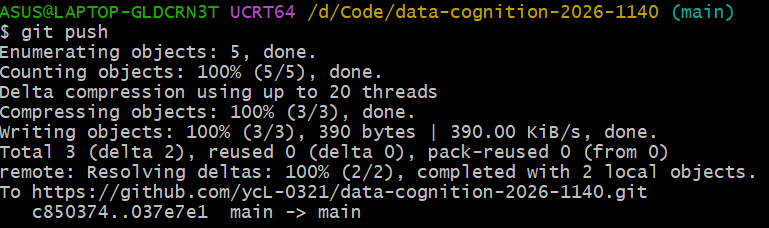

# 实验1收获
## 踩过的坑
1命令里的空格，执行‘git config --global user.name"Felix-ycL"’的时候少敲了一个空格命令没有报错，但是实际上什么都没写进去。后来用‘给i他config --global --list’才发现配置是空的。
2地址拼错，‘git clone’时漏掉了用户名和仓库名的/，Git提示repository not found;'cd'的时候又打错仓库名，提示目录不存在。后面用Tab键自动补全，这类错就没再犯并且效率更快。
3推送被重置，执行‘git push’时报‘Recv failure:Connection was reset’,后面发现是网络不稳定导致，换了网络环境后就成功推上去。

## Markdown 用法心得
`#` 表示一级标题，`##` 表示二级标题，`-` 开头是无序列表，`[文字](链接)` 是超链接，`` 是插图。
Markdown中单独换行不起作用，连续几行文字会被合并成一段，想让内容另起一段需要空行。
## 小结
这次实验将版本控制从概念变成了手上的操作。现在我知道了提交要写清楚说明，推送前先看‘git status’，出问题先读报错信息